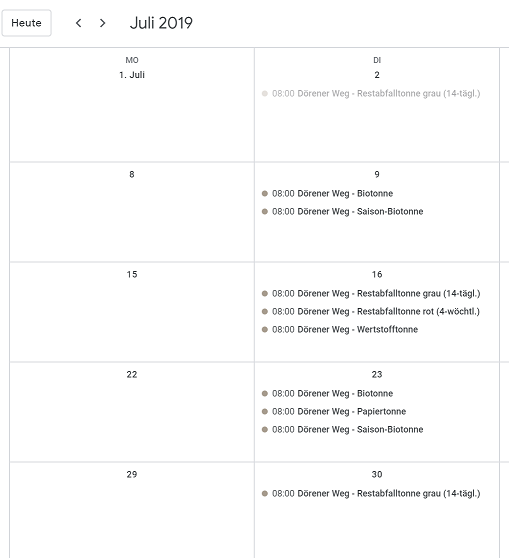
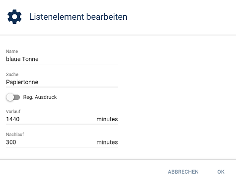
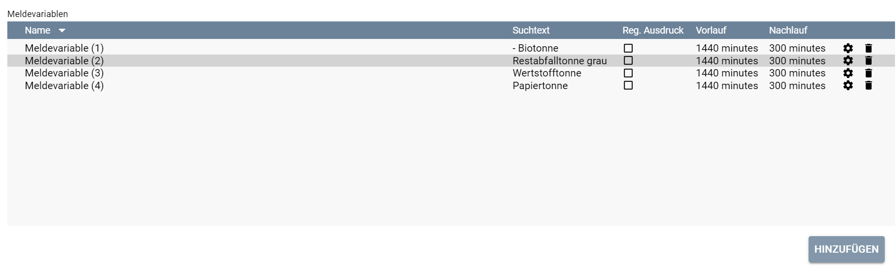
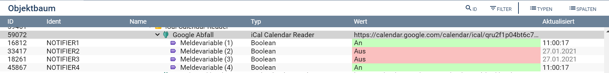
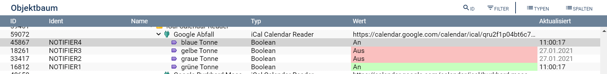

Read and process iCal calendars in Symcon
===

This library contains a module that feeds calendar information in iCal format into Symcon:
* **iCal Calendar Reader**

[Deutsche Version](readme.md)

**Table of contents**

1. [Features](#1-features)
2. [Requirements](#2-requirements)
3. [Software installation](#3-software-installation)
4. [Setting up the instances in Symcon](#4-setting-up-the-instances-in-symcon)
5. [Status variables and presentations](#5-status-variables-and-presentations)
6. [Visualization](#6-visualization)
7. [PHP command reference](#7-php-command-reference)

### 1. Features

The module reads calendar data into Symcon (tested with Google Calendar, ownCloud Calendar, Synology Calendar, iCloud and Office 365). The calendars can easily be shown in the visualization, and their dates can be evaluated to set status variables.
The data must comply with [rfc5545](https://tools.ietf.org/html/rfc5545 "Internet Calendaring and Scheduling Core Object Specification").

This makes it easy, for example, to keep a central presence calendar on the internet, and Symcon uses it to control heating, alarm system and presence simulation automatically.

Dates from public calendars (waste collection, cinema programme and so on) can be shown with little scripting as well. Waste collection dates, for example, can always be shown one day in advance.

When a calendar is loaded, its dates are converted from their own time zone into the local one, and recurring dates are stored as individual dates.

How calendar data from one or more **iCalCalendarReader** instances can be shown in a calendar control in the WebFront is described in the document [Kalender im WebFront anzeigen](docs/Examples/readme.md "Kalender im WebFront anzeigen") (German).

This library uses the following external libraries in the directory `libs`:
* iCalcreator (version 2.41.92) `https://github.com/iCalcreator/iCalcreator/tags`
* RRULE for PHP (version 3.0.0 - 2026-07-29) `https://github.com/rlanvin/php-rrule`, MIT licence

### 2. Requirements

- Symcon 8.0 or later
- a calendar in iCal format

### 3. Software installation

The module is installed through the Module Store.

### 4. Setting up the instances in Symcon

Add an instance **iCal Calendar Reader** under "Add instance".

#### Configuration page:

| Property                       | Type    | Default                | Description                                                                                                                                                                                                                            |
|--------------------------------|---------|------------------------|----------------------------------------------------------------------------------------------------------------------------------------------------------------------------------------------------------------------------------------|
| active                         | boolean | true                   | enables or disables the instance                                                                                                                                                                                                       |
| CalendarServerURL              | string  |                        | URL of the iCal source (Calendar URL)                                                                                                                                                                                                  |
| Username                       | string  |                        | user for accessing the source                                                                                                                                                                                                          |
| Password                       | string  |                        | password of this user                                                                                                                                                                                                                  |
| iCalMediaID                    | integer |                        | ID of a media object that contains a calendar file                                                                                                                                                                                     |
| DisableSSLVerifyPeer           | boolean | false                  | Disable Verification of SSL Certificate                                                                                                                                                                                                |
| DaysToCache                    | integer | 30                     | number of days for which future dates are read (Cache size (Future))                                                                                                                                                                   |
| DaysToCacheBack                | integer | 30                     | number of days for which past dates are read (Cache size (Past))                                                                                                                                                                       |
| UpdateFrequency                | integer | 15                     | how often the source is read, in minutes (Update Interval)                                                                                                                                                                             |
| WriteDebugInformationToLogfile | boolean | false                  | writes the debug information to the standard log file as well. <b>Important:</b> this needs the Symcon special switch 'LogfileVerbose'                                                                                                |
| <b>Notifiers</b>               |         |                        |                                                                                                                                                                                                                                        |
| Ident                          | string  | NOTIFIER + number      | ident of the status variable                                                                                                                                                                                                           |
| Find                           | string  |                        | search pattern the calendar entry is compared with                                                                                                                                                                                     |
| RegExpression                  | boolean | false                  | marks the search pattern as a regular expression. <b>Note:</b> a regular expression is normalized before use (missing delimiters are added).                                                                                          |
| Prenotify                      | integer | 0                      | how many minutes before the start of the date the status variable is set to "true"                                                                                                                                                     |
| Postnotify                     | integer | 0                      | how many minutes after the end of the date the status variable stays "true"                                                                                                                                                            |

#### Reading the calendar from a URL
The iCal servers expect the following URL formats:

**Google:**
`https://calendar.google.com/calendar/ical/(google-username)/private-(secret-hash-string)/basic.ics`  
In Google Calendar, click the gear at the top right of the main screen and choose *"Settings"*. In the calendar list on the left, click the name of the calendar to import. On the *"Calendar settings"* screen, copy the link shown under *"Secret address in iCal format"*.  

**OwnCloud:**
`http[s]://(server-name)[:server-port]/remote.php/dav/calendars/(user-name)/(calendar-name)?export`  
In the Calendar app, click *"..."* next to the calendar in the list on the left, then *"Link"*. Copy the link and append the suffix `?export`.  

**Synology:**
`http[s]://(server-name)[:server-port]/caldav/(user-name)/(calendar.name)--(suffix)`  
In the Calendar app, click the small triangle next to the calendar name in the list on the right, choose *"CalDAV Account"* and copy the address for Thunderbird from the pop-up.  

**iCloud:**
`https://(server).icloud.com/published/(number)/(secret-hash-string-1)-(secret-hash-string-2)`  
In the macOS Calendar app, right-click the iCloud calendar to import, choose *"Share"* and tick *"Public Calendar"*. Copy the link and replace the protocol `webcal` with `https`.
Alternatively, the link can be found in the web portal https://www.icloud.com/#calendar by opening the sharing settings of the calendar. Here, too, replace `webcal` with `https`.   

**Office 365:**
`https://outlook.office.365.com/owa/calendar/...systeme.de/.../calendar.ics`  
In Outlook on the web (OWA), publish a calendar under Settings > Calendar > Shared calendars and copy its ICS link.  

#### Reading the calendar from a file
To use an existing calendar file (for example an iCal file with the collection dates from the waste disposal company), first load it into a media object of type "Document" in Symcon and select this media object in the configuration.

Synchronization starts as soon as a URL or a media object is entered and saved. Every time the settings are applied, the calendar is read at once and all notifier variables are updated, even with an update interval of 0.

If the media object is deleted later or does not contain a file, the instance reads the calendar URL instead. Without a URL it goes to status 201 and reports the configuration error in the log.

If the notifier list is invalid (for example set by script as a twice encoded JSON text), the instance goes to status 208 and the log explains what the list must look like; existing notifier variables are kept.

Errors accessing the calendar are written to the system log (tab **Messages** in the Symcon Management Console), **once per problem** as a warning with the kind of error and the next step, for example "Calendar server https://… not reachable (…) - temporary, reading is retried every 15 minutes". While the same problem persists, further reads add no new entry; once it is solved, the log says "Calendar can be read again" once. Of the URL, only the server is logged, not the path (which holds the access token with iCloud and similar services).
Problems with single dates (for example an unknown time zone or a recurrence rule that cannot be evaluated) are also reported once as a warning with their number and the first problem, and again only when they change; when they are gone, the log says "Calendar imported without problems again" once. The debug output of the instance shows all details.
After a rejected login, an invalid URL or a response without calendar data, the instance only reads again once the corrected settings have been applied, so an account is not locked by repeated failed attempts.

#### Example for notifier variables
A waste collection calendar shows how to set up notifier variables. The screenshots are taken from a German installation.

**Scenario:**   
*A calendar contains the waste collection dates. On collection days, a status variable per kind of bin is to be set to 'true'.*

The entries in Google Calendar read

Now an entry is added under "Notifiers" for every status variable. In the example, a status variable for the paper bin is created. When a calendar entry contains the word "Papiertonne", the status variable is to be set to "true" 24 hours (= 1440 minutes) before and stay so until 5 hours after the date.

A regular expression can be used as search pattern, too. The button "Test Regular Expression" tries it out.
If a regular expression is invalid, this notifier never switches; its row in the list is highlighted, a note below the list names the expression (plus a warning in the log). The other notifiers and the reading of the calendar carry on.

Several web sites (for example [regular expressions 101](https://regex101.com/)) help with writing search patterns.

The other bins are set up the same way:

After saving the instance, the object tree contains the following variables:

The status variables can be renamed in the object tree as you like:

### 5. Status variables and presentations

For every notifier defined in the instance, a status variable with the ident 'NOTIFIER' and a running number is created.
The status variable shows whether a calendar entry is active, taking into account the times and the filter set in the module.

No custom variable profiles are created.

### 6. Visualization

The notifier variables use the presentation "Switch" and can be shown in the visualization directly.

### 7. PHP command reference

`json_string ICCR_GetCachedCalendar(integer $InstanceID);`   
Returns the cached calendar data, converted to the local time zone, as a JSON encoded string.

`void ICCR_TriggerNotifications(integer $InstanceID);`   
Checks at once whether the status variables need to be updated.
The module calls this function every minute.  

`json_string ICCR_UpdateCalendar(integer $InstanceID);`   
Reloads the calendar at once.
The module calls this function regularly, as set in the update interval.
Returns the cached calendar data, converted to the local time zone, as a JSON encoded string. 
 
`json_string ICCR_GetNotifierPresenceReason(integer $InstanceID, string $ident);`   
Returns the date that made the notifier variable with the ident `$ident` (for example `NOTIFIER1`) active at the last evaluation, as a JSON encoded string; if it was inactive or not evaluated yet, `[]`.
An unknown ident is reported as a warning that names the valid idents.

`string ICCR_RunSelfTest(integer $InstanceID);`   
Checks the instance and returns the result as text, one line per check (source, import, cache, notifiers) with the next step for errors; the last line reads `N errors, M warnings`. The texts appear in the language of the Symcon installation.
The calendar is read, but nothing is changed (no status, no variables, no cache). The form offers the button "Run self test (changes nothing)" for it.
